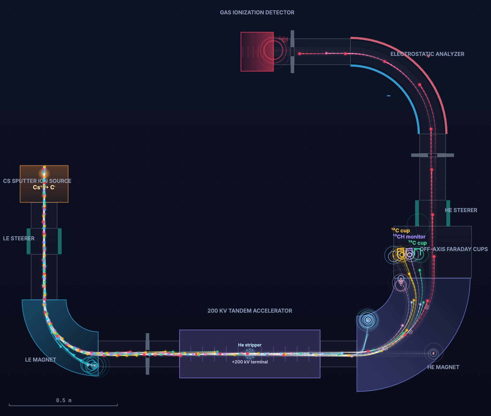
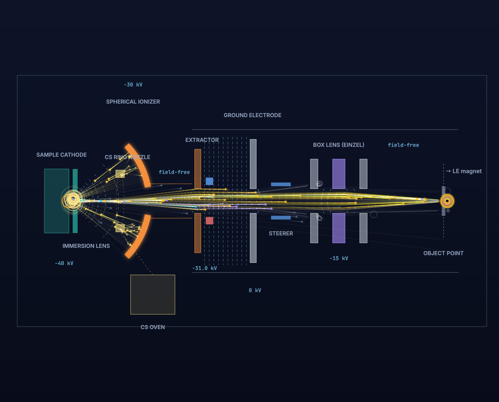

# MICADAS AMS Simulator

An interactive, browser-based particle-track simulation of a **MICADAS-type
accelerator mass spectrometer** (MIni CArbon DAting System, ETH Zurich /
Ionplus AG) for radiocarbon dating — built to show a non-scientific audience
how the carbon isotopes **¹²C, ¹³C, ¹⁴C** and the molecular interferences
**¹³CH, ¹²CH, ¹²CH₂** are separated, filtered and finally counted one atom at
a time. (¹²CH rides in the bouncer's mass-13 slot: its ¹²C fragment misses the
¹²C cup by a few mm, while a rare intact survivor has almost exactly the
rigidity of real ¹³C — the classic interference on the stable-isotope cups.)





## Quick start

```bash
./run.sh        # macOS / Linux
.\run.bat       # Windows (PowerShell; in cmd: run.bat)
# then open http://127.0.0.1:8550
```

(The script creates a local virtual environment, installs FastAPI + uvicorn
and starts the server.) For Windows/macOS installation, LAN access,
autostart and troubleshooting see **[INSTALL.md](INSTALL.md)**.

## What you can do

- **Step inside the ion source** (click it in the beamline, or use the
  "Ion source" tab): a cutaway simulation of the hybrid Cs sputter source
  with the potentials and electrode sequence of the CEZA MICADAS (ionizer
  −30 kV, cathode a further −10 kV, extractor ≈1 kV below the ionizer,
  box lens centre ≈ −15 kV): Cs vapour sprayed from a ring nozzle onto the
  ~1000 °C spherical ionizer → Cs⁺ (10 keV) focused through the immersion
  lens aperture onto the sample → sputtering → C⁻ turned forward in the
  pocket, crossover just past the lens plate, slow opening through the
  ionizer hole, focus trim at the extractor, +30 keV in the extraction gap,
  x/y steerer, box lens (einzel) focusing onto the object point of the LE
  magnet; co-extracted electrons removed by the suppressor magnets.
  Adjustable U_ion, U_cath, extractor offset, steerer and box-lens
  potentials, plus a graphite ↔ CO₂-gas target switch (C⁻ ~60 µA vs ~13 µA,
  with O⁻ dominating in gas mode). The **immersion lens** (target shield) that forms the slow,
  freshly sputtered anions into a beam can be switched off to see its effect:
  the plume sprays onto the ionizer and the output collapses from ~60 µA to
  ~14 µA (cf. the 2009 ETH source revision, where this passive lens replaced
  two actively powered lenses). A switchable **electric-field overlay** draws
  schematic equipotential lines that follow the live potentials: 1/r-spaced
  shells in the cathode–ionizer gap (the field crowds towards the target),
  meniscus curvature at the immersion lens and extractor, the near-uniform
  extraction column, and the field-free drift to the grounded exit — with
  live voltage labels (−40 kV → −33 kV → 0).

- **Tune the machine**: ion-source voltage, LE/HE steerer voltages, LE and HE
  magnet field strength, accelerator terminal voltage, ESA plate voltage.
  Every slider has a green tick at its *design value*; "⚡ Tune to optimum"
  glides everything back to the working point.
- **Toggle the bouncer** (sequential injection) and watch ¹²C/¹³C make — or
  miss — the mass-14 corner of the injection magnet.
- **Select isotopes / molecules** to visualize — including ¹⁶O⁻, the dominant
  ion from CO₂ gas targets, which is dumped on the LE-magnet outer wall
  (mass 16 has no bouncer slot). New species can be added in
  `server/physics/species.py` without touching any other code.
- **Hover any component** for a plain-language explanation of what it does.
- Watch the **measurements** in realistic machine units: the stylised
  simulation rates are calibrated onto real MICADAS readings — ¹²C/¹³C cup
  currents in µA, the ¹³CH monitor in nA, single-atom ¹⁴C counts/s, the
  ¹⁴C/¹²C ratio in ×10⁻¹², plus the resulting **radiocarbon age**.
- Choose the **sample in the ion source** (modern … 50,000 years … ¹⁴C-free
  blank): the ¹⁴C beam scales with the sample's F¹⁴C, the detector rate drops
  from ~160 counts/s (modern) to single counts, and the computed age follows.

## Physics model (MICADAS design values)

| Stage | Model |
|---|---|
| Cs sputter source | C⁻ extraction at 40 kV (adjustable 20–60 kV) |
| LE magnet | 90°, r = 250 mm, B ≈ 0.43 T for mass 14 at 40 keV; bouncer biases the chamber so masses 12/13 follow the same orbit |
| Tandem accelerator | vacuum-insulated, terminal +200 kV; He stripper at the terminal: charge flip −1 → +1, molecules dissociate (fragments keep the parent velocity), final energy 40 + 2×200 = 440 keV |
| HE magnet | 90°, r = 350 mm, B ≈ 1.02 T for ¹⁴C⁺ at 440 keV; off-axis Faraday cups collect ¹²C⁺ / ¹³C⁺, plus a **¹³CH monitor cup** between them that collects the ¹³C⁺ break-up fragments (≈423 keV) — its current × a calibration constant k predicts the molecular background in the detector ("predicted mol. bg" KPI vs. actual background events) |
| ESA | 90°, r = 380 mm, plate voltage ±40 kV — energy/charge filter |
| Detector | gas ionization counter, single-ion events |

Trajectories are first-order beam optics around the reference path
(`x″ = k₀ − k(particle)`), with curvature `k = qB/p` in magnets and
`k = qE/2E_kin` in the ESA. Ions whose offset exceeds the local aperture are
lost on the chamber wall (visible spark). Transverse offsets are drawn ~3×
exaggerated; beam intensities and the molecular survival probability are
stylised so that rare events stay visible.

## Architecture

```
server/                     Python (FastAPI + uvicorn) — single source of truth
  main.py                   app: serves frontend + /api/config
  physics/species.py        IonSpecies / FragmentSpec / StripperBehaviour (OOP registry)
  physics/beamline.py       Element / Bend / Beamline — geometry walk + nominal set-points
static/                     Frontend (ES6 modules, no build step)
  js/physics.js             constants, rigidity/curvature helpers
  js/elements.js            BeamElement class hierarchy (transport + geometry)
  js/engine.js              Particle + SimulationEngine (stepping, stripping, stats)
  js/renderer.js            three-layer canvas renderer (machine / trails / sprites)
  js/ui.js                  data-driven controls, hover info, measurements
  js/main.js                bootstrap + animation loop
```

The backend physics package is **object-oriented and data-driven**: adding an
isotope or molecule means adding one `IonSpecies` entry; adding a beamline
element means appending one object in `build_beamline()` — the frontend builds
its controls, chips, geometry and transport from `/api/config` automatically.

## References

- H.-A. Synal, M. Stocker, M. Suter: *MICADAS: A new compact radiocarbon AMS
  system*, Nucl. Instr. Meth. B 259 (2007) 7–13.
- Ionplus AG, MICADAS product specifications (200 kV vacuum-insulated tandem,
  He stripping, 90° magnets, 90° ESA r = 380 mm ± 40 kV).
